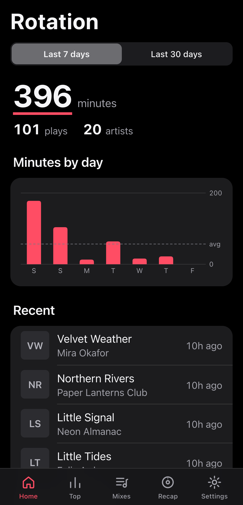
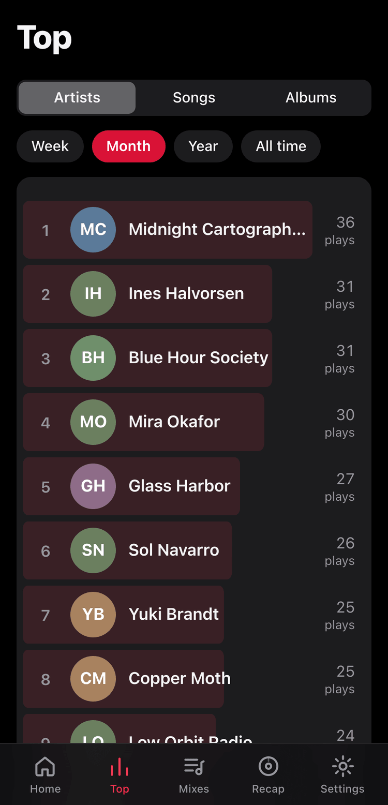
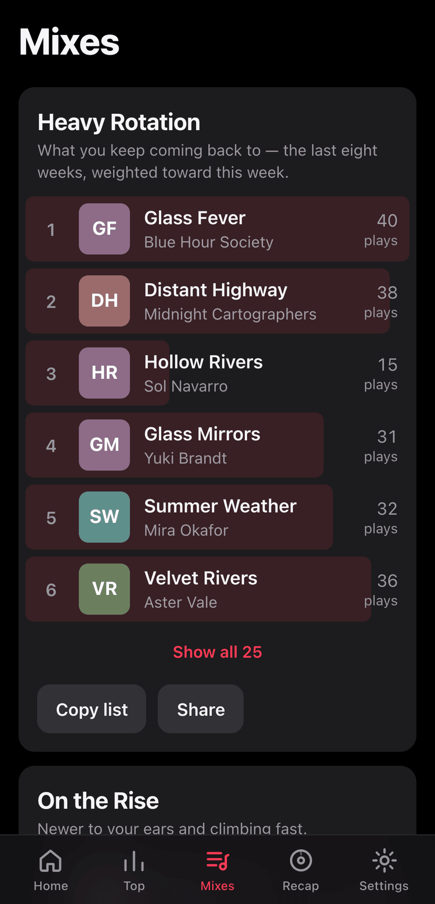
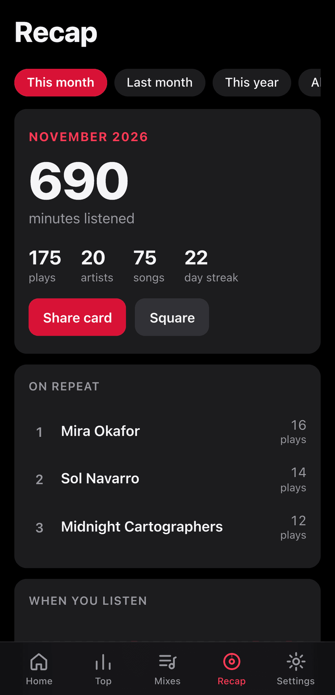

# Rotation

Your music listening stats, on your phone's home screen. Works with Apple Music
and Spotify, on iPhone and Android.

Rotation is a small installable web app (PWA) that tracks what you listen to and
turns it into stats: minutes listened, plays, top artists /
songs / albums, a listening-clock heatmap, streaks, skip analytics, and
shareable recap cards. Everything is stored on your device - there is no
backend and no account.

The **Mixes** tab distills the data into playlist-shaped lists of what you
actually like: *Heavy Rotation* (recency-weighted plays, corrected by how often
you finish the song and how many separate days you reached for it), *On the
Rise* (surging against your own baseline), *Old Flames* (heavily played, gone
quiet for 60+ days), and *No Skips* (never once cut short - counted only from
sources that report skips, i.e. the Apple and Spotify exports; Last.fm
doesn't). Each mix can be copied or shared as "Artist - Song" lines
(playlist importers read that format), and each row opens the song in Apple
Music or Spotify, whichever you picked.

<p>
  
  
  
  
</p>

*Screenshots use the built-in sample data: the artists are made up.*

## Try the demo

Open **[cypriant111.github.io/rotation/?demo](https://cypriant111.github.io/rotation/?demo)**
(or tap **See it with sample data** on the empty Home screen). It loads about six
months of invented listening history into memory, so every screen works right
away. Nothing is saved; **Exit demo** in the red bar takes you back.

## How it gets your listening data

Rotation never signs in to Apple or Spotify. It combines two sources:

1. **Last.fm (automatic, ongoing).** Last.fm records ("scrobbles") your plays:
   for Apple Music through the free Last.fm iPhone app, for Spotify through
   Spotify's own Last.fm connection. Rotation pulls them from the Last.fm API
   every time you open it.
2. **Privacy export (deep history).** Apple and Spotify will both send you your
   full play history on request; Rotation imports it locally and merges it
   with the Last.fm data (duplicates are detected and skipped).

Pick your service on the first screen (or later in Settings); it decides which
instructions you see and where song links open.

## Install on your phone

**iPhone:**

1. Open the deployed app in Safari.
2. Tap the share button, then **Add to Home Screen**.
3. **Open the installed app** and do your setup there - iOS gives the
   installed app its own separate storage, so anything you set up in the
   Safari tab does not carry over.

**Android:** open the app in Chrome and tap **Install** in the banner (or ⋮ ▸
**Install app**). The installed app shares its data with the browser.

## Set up automatic tracking (Last.fm)

**Spotify** (a few minutes, no extra app):

1. Create a free account at [last.fm/join](https://www.last.fm/join).
2. On last.fm open [Settings ▸ Applications](https://www.last.fm/settings/applications)
   and connect **Spotify Scrobbling**. Spotify now reports every play, from
   every device.
3. Get an API key at
   [last.fm/api/account/create](https://www.last.fm/api/account/create) (any
   application name) and enter it with your username in Rotation's Settings.

**Apple Music**, one-time, roughly five minutes:

1. Create a free account at [last.fm/join](https://www.last.fm/join).
2. Install the **Last.fm** app from the App Store and sign in.
3. In iPhone **Settings ▸ Music**, turn on **Use Listening History**. Give the
   Last.fm app access to Apple Music when it asks, and allow Background App
   Refresh.
4. While signed in on last.fm, open
   [last.fm/api/account/create](https://www.last.fm/api/account/create), enter
   any application name, submit, and copy the **API key**.
5. In Rotation's Settings tab, enter your username and that API key, then
   Connect. Your whole scrobble history is imported on first sync.

Heads-up: iOS doesn't let any app watch Apple Music in real time. The Last.fm
app reads your play history when it runs, so open it every day or two to keep
scrobbles flowing. (Paid alternative: Marvis Pro with its Last.fm add-on
scrobbles in real time because it *is* the player.)

## Import your full Apple Music history

1. Go to [privacy.apple.com](https://privacy.apple.com) ▸ *Get a copy of your
   data* ▸ select **Apple Media Services information**.
2. Apple prepares the archive within about a week and emails you.
3. Unzip it, open the **Apple Music Activity** folder, and import
   **`Apple Music - Play History Daily Tracks.csv`** in Rotation's Settings
   tab. Use this file, not the much larger `Apple Music Play Activity.csv`:
   recent exports of that one have no artist column (the app warns before
   importing any file over 50 MB).

The file is parsed entirely on your device and never uploaded.

## Import your full Spotify history

1. On [spotify.com/account/privacy](https://www.spotify.com/account/privacy/)
   tick **Extended streaming history** and request your data.
2. Spotify emails a download link, usually within days (at most 30).
3. Unzip it and select all the `Streaming_History_Audio_*.json` files at once in
   Rotation's Settings tab (with Spotify chosen as your service). Podcasts,
   audiobooks and video are left out; a stream counts as a play from 30
   seconds, and shorter ones you skipped feed the skip stats.

The one-year `StreamingHistory_music_*.json` files from Spotify's quicker
"Account data" download work too, but they carry no skip information.

## Development

```bash
npm install
npm run dev        # dev server at http://localhost:5173/rotation/
npm test           # vitest unit tests (stats engine, parsers)
npm run build      # production build to dist/
npm run icons      # regenerate PWA icons from the SVG master
npm run og         # regenerate the 1200x630 link-preview image (public/og.png)
```

With the dev server running, `node scripts/screenshots.mjs` drives headless
Chrome to refresh the README screenshots and reports each tab's
`scrollWidth` (horizontal-overflow check); see the options at the top of the
script.

Pushing to `main` deploys to GitHub Pages via `.github/workflows/deploy.yml`.
The Vite `base` is `/rotation/`; if you fork under a different repo name,
change `base` in `vite.config.ts` and the icon/start_url paths in
`index.html` / the PWA manifest accordingly.

## Privacy

- All listening data lives in IndexedDB on your device.
- The only network calls are to the Last.fm API, with your own API key (your
  scrobbles, and cover lookups that send the artist and title of the songs
  and albums on screen), and Last.fm's image CDN for the covers. Without a
  Last.fm key there are none. No Apple or Spotify login, no Spotify Web API.
- Settings ▸ Data lets you export everything as JSON or delete it per source.

Rotation is not affiliated with Apple, Spotify or Last.fm.
